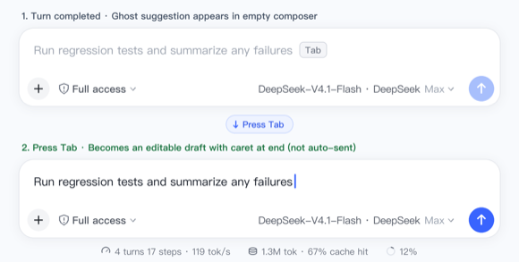

# dsh-next-step-suggestion

English | [中文](README.zh.md)

**Codex-style ghost next-step prompt suggestions for DeepSeek Harness Web.**<br />
When an agent finishes a turn in the active conversation, an empty composer previews one concise, directly sendable follow-up instruction. Press **`Tab`** to accept it as an editable draft, then submit whenever you are ready.

<p align="center">
  
</p>

## Features

- **Restrained, exact trigger conditions** — Appears only in the foreground conversation after a normal turn completion (`turn/end` with `reason.kind === 'completed'`) while the composer text and attachments are empty and no `/` or `@` completion menu is open. Streaming, tool execution, permission prompts, `ask_user_question` waits, cancellations, and errors are skipped.
- **Two-step safe acceptance** — The gray ghost preview is rendered separately from the Lexical editor value. Pressing **`Tab`** while the editor holds focus converts the preview into an editable draft with the caret at the end—never auto-submitting.
- **Single-shot, bounded background generation** — Dispatches at most one tool-free `ctx.llm` call per `(sessionId, turn)` using only recent human/assistant text and tool-call counts. Full transcripts, system prompts, reasoning traces, and raw tool outputs are never sent, and nothing is written to the session log.
- **One-shot invalidation & multi-session isolation** — Suggestions are isolated per `sessionId`: switching to another session hides the previous session's preview (never leaking across sessions), while returning to a clean, unconsumed session restores its suggestion or backfills a turn that just completed in the background (skipping cold historical sessions). Typing, IME composition, pasting, pressing **`Esc`**, deleting back to empty, or starting a new turn permanently invalidates that turn's suggestion.

## Installation

### CLI

```sh
# Install from GitHub or a local checkout
dsh plugin --profile web add github:Panmax/dsh-next-step-suggestion
# or: dsh plugin --profile web add /path/to/dsh-next-step-suggestion

# Enable or disable at any time (hot-reloads with HMR)
dsh plugin --profile web enable dsh-next-step-suggestion
dsh plugin --profile web disable dsh-next-step-suggestion

# Remove the bundle
dsh plugin --profile web remove dsh-next-step-suggestion
```

### Web UI

1. Open **Plugins** in the left sidebar.
2. Click **Add plugin** and supply the package path or repository URL.
3. Toggle **Next-step suggestion** on or off at any time—disabling unmounts the overlay slot, removes plugin styles, and stops all background generation requests immediately.

## Keyboard & Interaction Matrix

| Context | Action | Result |
| --- | --- | --- |
| Preview visible + composer focused + no popup open | `Tab` | Accepts suggestion into editable draft, moves caret to end, does **not** send |
| Preview visible + composer focused + no popup open | `Esc` | Dismisses and invalidates the current turn's preview |
| Preview visible + focus outside composer | `Tab` | Preserves native browser focus traversal |
| `/` or `@` menu / command popup open, or `Shift+Tab` | `Tab` / `Esc` | Preview hides and yields completely to built-in composer menus |
| User types, pastes, or accepts then clears back to empty | Any edit | Current turn's suggestion is permanently invalidated until the next turn finishes |

## Configuration

Optional fields under the `next-step-suggestion` entry in `cordis.patch.yml`:

```yaml
- insert:
    - id: next-step-suggestion
      name: 'dsh-next-step-suggestion'
      config:
        maxInputBytes: 6000
        maxOutputTokens: 4096
        timeoutMs: 30000
        # Optional explicit route override (defaults to the active session's model):
        # provider: deepseek
        # model: deepseek-flash
```

| Field | Default | Description |
| --- | --- | --- |
| `maxInputBytes` | `6000` | Maximum UTF-8 bytes of recent turn summary sent to the auxiliary model call. |
| `maxOutputTokens` | `4096` | Output token ceiling (accommodates thinking models whose non-disableable reasoning tokens share `maxTokens`). |
| `timeoutMs` | `30000` | End-to-end deadline in milliseconds for one background suggestion call. |
| `provider` | Session route | Optional explicit LLM provider id (must be supplied together with `model`). |
| `model` | Session route | Optional explicit model id (must be supplied together with `provider`). |

## Architecture

- **Host (`index.js`, `src/host.js`, `src/context.js`)** — Registers `POST /api/next-step-suggestion/suggest` on `ctx.webServer` behind `ctx.connection.requestRejection` authentication, verifies `agent.status === 'idle'` and `turn/end` (`completed`) on `ctx.agents`, extracts bounded context, deduplicates per `(sessionId, turn)`, calls `ctx.llm.prepareCall` at minimum reasoning effort without tools, and aborts in-flight calls on `agent/status` (`running`) or `session/disposed`.
- **Client (`client.js`, `src/client-core.js`, `src/client-entry.js`)** — Registers into `conversation.input.overlay`, subscribes to `useSession`, `useInput`, `useProjection('turnOutline' | 'conversationContinuation')`, `ctx.inputTriggers`, and `ctx.commandUi`, styles exclusively with `--dsw-*` theme tokens, and arbitrates bubble-phase `keydown` events after Lexical's `COMMAND_PRIORITY_CRITICAL` handlers.

## Development

```sh
npm run build        # Bundle src/client-core.js + src/client-entry.js into client.js
npm test             # Run Node test suite (context bounds, Host API, acceptance & async races)
npm pack --dry-run   # Inspect packaged file list
```

## License

[MIT](LICENSE)
