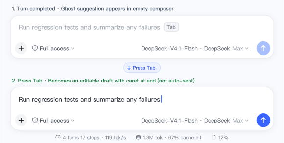
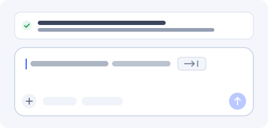
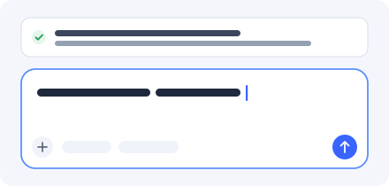

# dsh-next-step-suggestion

[English](README.md) | 中文

**面向 DeepSeek Harness Web 的 Codex 风格「下一步建议」插件。**<br />
当前台会话中的 Agent 正常完成一轮工作且输入框为空时，输入框内会以柔和灰色预览一条简短、可直接发出的后续指令。聚焦输入框按 **`Tab`** 即可将其采纳为可编辑草稿，再按发送键才会发出。



## 核心特性

- **克制、精准的触发条件** —— 仅在前台聊天会话正常完成一轮回复（`turn/end` 且 `reason.kind === 'completed'`）、输入框文本与附件均为空、且无 `/`、`@` 或命令选择弹层打开时显示。流式输出、工具执行、权限审批、等待用户回答、手动取消和运行报错时均自动跳过。
- **两步式安全采纳（预览 → 草稿 → 发送）** —— 灰色预览层与 Lexical 编辑器实际值完全隔离。仅当焦点位于输入框内时按 **`Tab`** 才会将建议写入草稿并将光标移至末尾，绝不自动发送。
- **单回合单次、有界零污染生成** —— 每个正常结束的 `(sessionId, turn)` 最多调用一次无工具 `ctx.llm` 请求，仅提取最近两轮用户消息、本轮最终回复摘要与工具调用计数；绝不上传完整历史、系统提示词、思维链或原始工具日志，不写入会话事件记录。
- **多会话隔离保留与后台补拉** —— 状态按 `sessionId` 独立隔离：切去其他会话时自动隐藏原会话预览（绝不串台），切回未编辑、未消费的原会话时自动恢复预览，或自动补拉后台刚运行完的最新回合建议（冷启动历史旧会话不会误触发）。开始输入、输入法组合、粘贴、按 **`Esc`**、采纳/输入后删空或开启新回合均会永久作废该轮建议。

## 效果预览

<table>
  <tr>
    <td align="center">
      <br>
      <sub><b>1. 回合正常完成</b> —— 空输入框浮现灰色建议与 <code>Tab</code> 标识，草稿仍为空，发送按钮保持未激活</sub>
    </td>
    <td align="center">
      <br>
      <sub><b>2. 按 <code>Tab</code> 接受</b> —— 建议转为深色可编辑草稿、光标移至句尾、发送按钮亮起待发送（聊天流无自动消息）</sub>
    </td>
  </tr>
</table>

## 安装与管理

### 命令行（CLI）

```sh
# 从本地目录安装到 web Profile
dsh plugin --profile web add /path/to/dsh-next-step-suggestion

# 随时启用或禁用（HMR 实时热生效）
dsh plugin --profile web enable dsh-next-step-suggestion
dsh plugin --profile web disable dsh-next-step-suggestion

# 卸载插件
dsh plugin --profile web remove dsh-next-step-suggestion
```

### Web 图形界面

1. 打开左侧边栏的 **插件（Plugins）** 页面。
2. 点击 **添加插件（Add plugin）**，填入本地插件目录路径或仓库地址完成安装。
3. 可随时切换 **下一步建议** 开关 —— 禁用后将立即注销前端 Slot 与样式、卸载后端路由并中止在途请求，不再发起任何生成请求，也不影响输入框与按键行为。

## 键盘与交互行为

| 当前状态 | 用户操作 | 行为结果 |
| --- | --- | --- |
| 预览可见 + 输入框已聚焦 + 无弹层打开 | `Tab` | 将建议填入输入框作为可编辑草稿，光标置于末尾，**不自动发送** |
| 预览可见 + 输入框已聚焦 + 无弹层占用 `Esc` | `Esc` | 关闭并作废本轮预览，后续按键恢复默认行为 |
| 预览可见 + 焦点在输入框外部控件 | `Tab` | 保持浏览器原生焦点切换，不拦截按键 |
| `/`、`@` 补全菜单或命令弹窗打开，或按 `Shift+Tab` | `Tab` / `Esc` | 自动隐藏预览，按键 100% 交由原有补全面板处理 |
| 开始打字、输入法组合、粘贴，或采纳/输入后又删空 | 任意编辑 | 本轮建议永久失效，删空后不会重新弹出，直至下一轮正常完成 |

## 配置项

可在当前 Profile 或插件的 `cordis.patch.yml` 中调整 `next-step-suggestion` 配置：

```yaml
- insert:
    - id: next-step-suggestion
      name: 'dsh-next-step-suggestion'
      config:
        maxInputBytes: 6000
        maxOutputTokens: 4096
        timeoutMs: 30000
        # 可选：显式指定用于生成建议的模型路由（默认跟随当前会话模型）
        # provider: deepseek
        # model: deepseek-chat
```

| 字段 | 默认值 | 说明 |
| --- | --- | --- |
| `maxInputBytes` | `6000` | 传给辅助建议请求的近期回合摘要最大 UTF-8 字节数。 |
| `maxOutputTokens` | `4096` | 单次建议生成的最大输出 token 上限（兼容不可关闭思考过程的推理模型）。 |
| `timeoutMs` | `30000` | 单次后台建议请求的超时时间（毫秒）。 |
| `provider` | 跟随当前会话模型 | 可选模型提供商 ID（须与 `model` 成对配置）。 |
| `model` | 跟随当前会话模型 | 可选模型 ID（须与 `provider` 成对配置）。 |

## 架构与复用扩展点

- **Host 端（`index.js`、`src/host.js`、`src/context.js`）** —— 基于 `ctx.webServer.register` 注册 `POST /api/next-step-suggestion/suggest` 并复用 `ctx.connection.requestRejection` 同源鉴权；通过 `ctx.agents` 与 `session.snapshotEvents()` 校验空闲状态及 `turn/end`（`completed`），按 `(sessionId, turn)` 幂等单飞调用 `ctx.llm.prepareCall`（自动选取最低 `reasoningEffort`、零工具定义），并在 `agent/status`（`running`）与 `session/disposed` 时自动取消过期请求。
- **Client 端（`client.js`、`src/client-core.js`、`src/client-entry.js`）** —— 挂载至 `conversation.input.overlay` Slot，订阅 `useSession`、`useInput`、`useProjection('turnOutline' | 'conversationContinuation')`、`ctx.inputTriggers` 与 `ctx.commandUi`；全量使用 `--dsw-*` 宿主主题 Token 适配亮暗色模式，并在 `[data-composer-card]` 冒泡阶段执行按键仲裁以让位于 Lexical `COMMAND_PRIORITY_CRITICAL` 处理器。

## 本地开发与测试

```sh
npm run build        # 由 src/client-core.js 与 src/client-entry.js 生成单文件 client.js
npm test             # 运行全部单元与端到端竞态测试（node:test）
npm pack --dry-run   # 校验 npm 发布包文件列表
```

## 许可证

[MIT](LICENSE)
